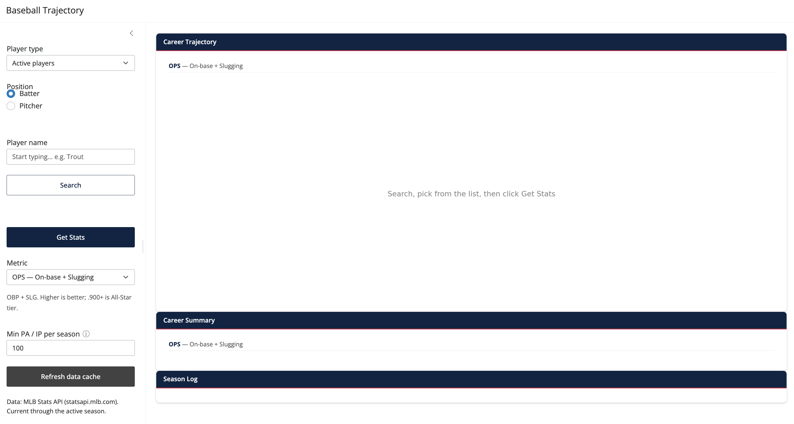

# baseball-trajectory

A small Shiny app for visualizing a baseball player's career arc on a single
metric — e.g. **OPS** (on-base + slugging) for batters or **ERA** (earned
run average) for pitchers. It pulls per-season stats from the MLB Stats
API, fits a weighted quadratic aging curve, and plots the player's
trajectory with a 95% confidence band and a marked peak age.

**Batter metrics**: OPS (on-base + slugging), OBP (on-base percentage),
SLG (slugging percentage), AVG (batting average), HR (home runs),
ISO (isolated power; `SLG − AVG`).

**Pitcher metrics**: ERA (earned run average), WHIP (walks + hits per
inning pitched), K/9 (strikeouts per 9 innings), BB/9 (walks per 9
innings), HR/9 (home runs per 9 innings). Lower is better for ERA,
WHIP, BB/9, and HR/9.

See `user_guide/03-metrics.qmd` for full definitions, formulas, and benchmarks.



## What you can do

- See when a player peaked, how steeply they declined, and how well a
  smooth curve fits across seasons.
- Compare a player on any of the metrics listed above.
- Look up active players via fast typeahead, or recently-retired
  players via a deeper search.
- Filter out cups-of-coffee seasons with the *Min PA / IP* knob
  (minimum plate appearances for batters or innings pitched for
  pitchers).

## Install

Create and activate a virtual environment first (required on Debian/Ubuntu
and other externally-managed Python installs — `.venv/` is already
git-ignored):

```bash
python3 -m venv .venv
```

```bash
source .venv/bin/activate
```

Then install in editable mode with the dev extras:

```bash
pip install -e ".[dev]"
```

## Run

```bash
baseball-trajectory
```

Then open <http://127.0.0.1:8000> in a browser.

## Usage

The sidebar workflow is two-step: **find a player, then load their
stats.** Each step has its own button.

1. **Player type** — *Active players* (fast typeahead, current season +
   3 prior) or *Retired players* (deeper window, ~50 seasons).
2. **Position** — *Batter* or *Pitcher*. Swaps the metric list and the
   weight column.
3. **Type a name** in the *Player name* box (≥2 characters). The
   dropdown auto-populates as you type, with each row labelled
   *Player Name — Position (Debut–Final)*, e.g.
   *Mike Trout — CF (2011–Active)*. The dropdown is **filtered by
   the Position toggle**: *Pitcher* only shows `P` and `TWP`
   (two-way players); *Batter* shows everything except pure pitchers.
   That stops you from picking a position player while *Pitcher* is
   selected and seeing an empty curve.
4. **Pick a player** from the dropdown. A small info card appears
   beneath the picker showing the full name, position, and
   debut–final seasons.
5. **Click *Get Stats***. The trajectory plot, career summary, and
   season log all update.

The plot only updates on Get Stats — picking from the dropdown alone
does nothing — so the chart stays stable while you browse search
results.

**Looking up a retiree?** Switch *Player type* to *Retired players*.
The auto-typeahead window widens to ~50 seasons (Griffey, Pedro,
Nolan Ryan, etc. all come up). For pre-1976 retirees, click the
*Search* button to do an even deeper ~80-season lookup.

Other controls:

- **Metric** — drives the y-axis of the trajectory plot. The dropdown
  labels expand the acronyms (e.g. *OPS — On-base + Slugging*,
  *ERA — Earned run average*).
- **Min PA / IP per season** — filters out partial seasons before the
  curve is fit. Hover the *ⓘ* icon next to the label for details.
- **Refresh data cache** — clears the in-process cache so the next
  search re-downloads from the MLB Stats API.

## Data sources

Stats come from the **MLB Stats API** (`statsapi.mlb.com`), the official
source of record for Major League Baseball statistics. Data is current
through the active season and is updated nightly by MLB. All endpoints
are called directly via `requests`:

- `GET /api/v1/sports/1/players?season={year}` — full season roster, used
  for typeahead and deep search.
- `GET /api/v1/people/{id}` — biographical data (birth date, full name).
- `GET /api/v1/people/{id}/stats?stats=yearByYear&group={group}` — per-
  season career splits.

All API responses arrive as Python dicts/lists and are converted to Polars
DataFrames immediately. Use `baseball_trajectory.data.refresh_cache()`
(or the *Refresh data cache* sidebar button) to force a re-fetch within a
running session.

## Tech stack

- **[Polars](https://pola.rs/)** for all data manipulation (no pandas in
  this codebase; all API responses are converted from dicts/lists directly).

- **[requests](https://requests.readthedocs.io/)** for direct calls to the
  MLB Stats API.

- **[statsmodels](https://www.statsmodels.org/)** for the weighted
  least-squares aging-curve fit.

- **[matplotlib](https://matplotlib.org/)** for the trajectory chart.

- **[Shiny for Python](https://shiny.posit.co/py/)** (core API, not
  express) for the UI.

## Modeling approach

For each player, the app fits a weighted quadratic curve to per-season
metric values:

```
y = a + b * Age + c * Age^2
```

The fit is a weighted least-squares regression with weights equal to plate
appearances (PA, batters) or innings pitched (IP, pitchers), so seasons
with more playing time pull the curve harder than partial seasons. When
the quadratic term `c` is negative, the curve has a maximum at
`Age = -b / (2c)` — that's the player's fitted **peak age**.

Predictions over a fine age grid include a 95% confidence band, drawn as a
shaded ribbon on the chart.

## Project structure

```
baseball-trajectory/
├── pyproject.toml
├── requirements.txt        # runtime deps for Connect Cloud
├── app.py                  # Connect Cloud primary-file shim
├── README.md
├── .gitignore
├── great-docs.yml          # docs site config
├── assets/                 # README-only images (landing page screenshot)
├── src/
│   └── baseball_trajectory/
│       ├── __init__.py     # version
│       ├── __main__.py     # console-script entry point
│       ├── data.py         # MLB Stats API queries + Polars loaders
│       ├── model.py        # WLS aging-curve fit + summaries
│       ├── plots.py        # matplotlib trajectory chart
│       └── app.py          # Shiny UI + server
├── user_guide/              # Great Docs narrative sources (.qmd)
├── tests/
│   ├── __init__.py
│   └── test_model.py
└── .github/
    └── workflows/
        └── docs.yml        # CI auto-deploy docs to GitHub Pages
```

## Documentation

Full user docs (Getting started, User guide, Modeling approach, Data
sources, API reference, Limitations) live under `user_guide/` and are
built with [Great Docs](https://posit-dev.github.io/great-docs/),
which also auto-generates the API reference from docstrings and turns
this README into the site's landing page.

Install the docs extras (requires [Quarto](https://quarto.org/) on
`PATH`):

```bash
pip install -e ".[docs]"
```

Build the static site to `great-docs/_site/`:

```bash
great-docs build
```

Preview it locally:

```bash
great-docs preview
```

## Publishing

### Documentation → GitHub Pages

After pushing the project to a GitHub repository, the docs can be served
from `https://<user>.github.io/<repo>/` via GitHub Pages.

The workflow at `.github/workflows/docs.yml` (generated with
`great-docs setup-github-pages`) builds the site with Quarto on every
push and pull request, and deploys it to GitHub Pages on pushes to
`main` — including PR preview deployments. To enable it:

1. Settings → Pages → *Source*: **GitHub Actions**
2. Push to `main`. The workflow runs and publishes the artifact.

The first run requires a workflow approval if your account uses
required-reviewer policies on Pages deployments.

To regenerate the workflow (e.g. after changing Python version or
package manager), run `great-docs setup-github-pages --force` again.

### App → Posit Connect Cloud

The repo includes two files at the root that make the project
deployable to [Posit Connect Cloud](https://connect.posit.cloud/) out
of the box:

- `requirements.txt` — Connect Cloud's installer reads only this file.
  It does not run `pip install -e .` against `pyproject.toml`.
- `app.py` (at the root) — a deployment shim. Connect Cloud loads its
  *primary file* and looks for an `app` object; this shim adds `src/`
  to `sys.path` and re-exports the Shiny app from
  `baseball_trajectory.app`.

To deploy:

1. Push the project to a GitHub repository (Connect Cloud deploys from
   GitHub).
2. In Connect Cloud, click **New Content → Shiny for Python**.
3. Select your GitHub repository and branch.
4. Set **Primary file** to `app.py` (the root one, not
   `src/baseball_trajectory/app.py`).
5. Click **Deploy**.

The app reaches out to `https://statsapi.mlb.com` for roster and career
data — if your Connect Cloud account has egress controls, allowlist
that host.

For full deployment details (pinning, container deploys, other Shiny
hosts), see the Deployment page (`user_guide/07-deployment.qmd`) in
the docs site.

### Package distribution

GitHub Pages doesn't host Python packages — that's PyPI's job. Until
the package is on PyPI, users can install it directly from a GitHub
URL.

From the default branch:

```bash
pip install git+https://github.com/<user>/baseball-trajectory.git
```

From a tagged release (recommended once you've cut one):

```bash
pip install git+https://github.com/<user>/baseball-trajectory.git@v0.1.0
```

To cut a release, create an annotated tag and push it:

```bash
git tag -a v0.1.0 -m "v0.1.0"
```

```bash
git push origin v0.1.0
```

Then attach release notes via the GitHub *Releases* UI or the `gh`
CLI.

If you later publish to PyPI, the `hatchling` build backend already
configured in `pyproject.toml` is sufficient — `python -m build`
produces both wheel and sdist, and `twine upload dist/*` pushes them.

## Limitations

- Typeahead covers the current season + 3 prior seasons only — fast, but
  retirees won't show up in the live dropdown. Clicking *Search* with no
  match falls back to a ~30-season deep lookup that covers most modern
  retirees (back to roughly 1996 from a 2026 perspective).
- Players who retired before the deep-search window aren't reachable
  through the UI. The MLB Stats API has older records; if you need them,
  the app would have to call the all-time `/people/search` endpoint.
- The aging-curve fit assumes a single quadratic shape. Players with
  unusual career arcs (late bloomers, injury-shortened careers, mid-career
  position changes) won't be modeled well.
- Multi-team seasons (when a player is traded mid-year) are aggregated by
  summing counting stats; ERA and all per-9 rates are recomputed as
  IPouts-weighted averages across stints.
- No park or league-strength adjustments — raw counting and rate stats only.
- Age is computed as of July 1 of each season (the standard mid-season rule);
  players born in July or later are counted as one year younger.
