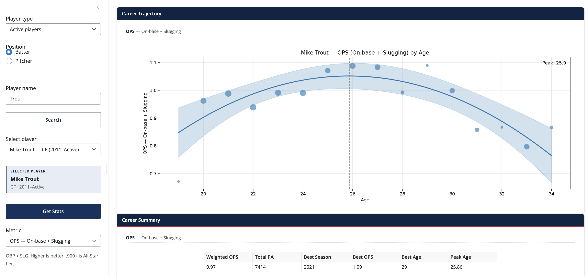

## Prerequisites

* Python 3.10 or newer.
* An internet connection (the first search downloads a season roster
  from the MLB Stats API).

## Install

The project uses [`uv`](https://docs.astral.sh/uv/) to manage Python,
the virtual environment, and dependencies. Clone the repository, then
sync the environment from the lockfile (`uv.lock`):

```bash
uv sync
```

`uv sync` creates `.venv/` (already git-ignored), installs the package
in editable mode, and adds the `dev` group (`pytest` and `ruff`).

## Run

Start the Shiny server:

```bash
uv run baseball-trajectory
```

The app binds to `127.0.0.1:8000`. Open <http://127.0.0.1:8000> in a
browser.

## Your first trajectory

1. Leave **Player type** on *Active players* and **Position** on
   *Batter* (the defaults).
2. Type `Trout` in the **Player name** box. The dropdown populates
   with matches as you type. Each row shows the player's position,
   e.g. *Mike Trout — CF (2011–Active)*.
3. Pick **Mike Trout** in the dropdown. A small info card appears to
   confirm the pick (full name, position, and debut–final seasons).
4. Click **Get Stats**. The trajectory plot, career summary, and
   season log fill in.
5. Try changing **Metric** from `OPS — On-base + Slugging` to `HR —
   Home runs` to see his home-run arc.

{width=720px fig-alt="Mike Trout's OPS-by-age trajectory"}

### Looking up a retiree

Toggle **Player type** to *Retired players*, then type a name such
as `Griffey` or `Ryan`. The auto-typeahead window widens to ~50
seasons in this mode, so older retirees come up directly. If a name
still doesn't appear, click the **Search** button for an even deeper
lookup. See the [User guide](02-user-guide.qmd) for the full
workflow.

## Stopping the server

Press `Ctrl-C` in the terminal where `baseball-trajectory` is running.

## How it works

```{mermaid}
%%| fig-width: 7
%%| fig-align: 'center'
%%{init: {'theme': 'base', 'themeVariables': { 'fontFamily': 'monospace', "fontSize":"20px", "darkMode":false}}}%%

flowchart TD
    U(["Browser"])
    API["MLB Stats API"]
    subgraph Pkg["<strong>baseball_trajectory</strong>"]
        D[["data<br>search_player<br>get_*_career"]]
        M[["model<br>WLS fit, peak age"]]
        P[["plots<br>trajectory chart"]]
        A("app<br>Shiny UI + server")
    end
    U --> A
    A --> D
    API --> D
    D --> M
    M --> P
    P --> A

style Pkg fill:#FFFFFF,color:#000000,stroke:#333,stroke-width:1px,rx:10,ry:10
style D fill:#4CBB9D,color:#FFFFFF,rx:5,ry:5
style M fill:#4CBB9D,color:#FFFFFF,rx:5,ry:5
style P fill:#4CBB9D,color:#FFFFFF,rx:5,ry:5
style A fill:#4CBB9D,color:#FFFFFF,rx:5,ry:5
```

[Code structure](09-code-structure.qmd) shows the call trees between
these modules, built from the source on every docs build.

## Next

* Read the [User guide](02-user-guide.qmd) for the full sidebar walkthrough,
  including how to look up older retired players.
* See the [Deployment](07-deployment.qmd) page if you want to host the app
  yourself (Posit Connect Cloud, Docker, etc.).
